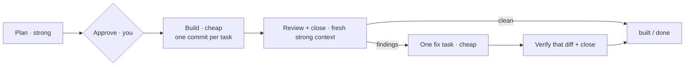

# Clean Dev

A lean agent skill for building applications in small approved phases, with engineering records that stay true. A strong model decides what must hold, a cheaper model decides how, and a fresh reviewer reads the real diff once.

- **Foundations once.** Constraints and stack decisions with their tradeoffs, an as-built architecture with a context diagram, living specs per area, and one owner per concern. Plans cite them instead of copying them.
- **Plans state the change.** Requirements tagged against spec rules, exact contracts only where a seam changes, choices with the alternative they rejected, and outcome tasks with `Done when:`. No private helpers, file lists, or coding steps.
- **Git is the audit trail.** Each task is one commit whose trailers record the check that ran, the builder's choices, and follow-ups. The plan's short Log holds only what git can't: blocks, review findings, and the outcome.
- **One review round.** The reviewer fixes trivial findings inline, sends the rest to one fix task, verifies only that diff, and closes the phase in the same pass.
- **Closing harvests.** Requirements fold into specs, lessons into AGENTS.md, and loose ends into the backlog, so the next plan starts from current truth.

## Install

Install with [Vercel's Skills CLI](https://github.com/vercel-labs/skills):

```bash
npx skills add visheshgubrani/clean-dev --skill clean-dev -g
```

The CLI lets you choose your coding agent. Omit `-g` to install only in the current project. The skill uses the standard `SKILL.md` format and works with any language or framework. The two scripts need Python 3.9+ and git, and no packages.

## The loop



| Step | Model | Prompt |
| --- | --- | --- |
| Plan | strong | `Use $clean-dev to plan the next phase: <what you want>.` |
| Approve | you | `Approve P07.` (or `Approve P07 T01–T04.`) |
| Build | cheap | `Use $clean-dev to build P07.` |
| Review and close | strong, new session | `Use $clean-dev to review P07.` |
| Fix, if needed | cheap | `Use $clean-dev to build P07 T05.` then review again, which checks only the fix |

Other entry points:

- **New app:** `Use $clean-dev to start <app idea>. Write the foundations and plan P01.`
- **Existing repo:** `Use $clean-dev to adopt this repo.` This archives old phase docs and writes the foundation records.
- **Bug:** `Use $clean-dev to plan a fix for <symptom>.` A small change with a clear cause that touches no contract, schema, or dependency is a direct change; just ask.

What each model does:

| Strong model (planner, reviewer) | Cheap model (builder) |
| --- | --- |
| Constraints, stack decisions, architecture, specs, owners, Patterns | Reads the code, the plan, and the phase's commit trail |
| Requirements tagged against spec rules, and the failure cases | Picks internal files, helpers, and signatures; searches owners before adding any |
| Exact contracts where the phase changes a seam | Implements, writes tests, runs the checks, and commits each task with trailers |
| Task order, spikes with decision rules, at most one checkpoint | Keeps commands, owners, and module rows current |
| One review of the real diff; folds the phase into specs at close | Runs the Phase diff pre-flight; blocks only when the approved design would change |

## Project records

| Record | Holds |
| --- | --- |
| `AGENTS.md` | Summary, commands, owners, Patterns, "When you change", Gotchas, rules. 80 lines or fewer, never status. |
| `docs/ARCHITECTURE.md` | Structure as built: context diagram, modules, import direction, invariants (`I01…`), boundaries, glossary. |
| `docs/specs/<area>.md` | What one area does now: rules (`R1…`), a flow diagram, pointers to contract files. |
| `docs/DECISIONS.md` | Lasting choices (`D001…`) with the rejected alternative and when to revisit, 8 lines each. |
| `docs/ROADMAP.md` | Goal, constraints, the phase table (the **only** place for status), outlines, backlog by area. |
| `docs/plans/P07-slug.md` | Goal, requirements, design at the seams, tasks, acceptance, and an append-only Log. |
| git | One commit per task: `P07-T03 <title>` with `Check:`, `Choices:`, and `Follow-up:` trailers. |

Each ID has one shape and one meaning: `P07` is a phase (one user-visible outcome), `P07-T03` a task (one commit), `C1` a plan requirement, `checkout R6` a spec rule, `D014` a decision, and `I05` an invariant. IDs are never lettered, reused, or put in code. Phase status goes `planned → approved → built → done`, plus `dropped`.

## Scripts

```bash
python3 <path-to-skill>/scripts/check_docs.py <project-root>   # lint the records
python3 <path-to-skill>/scripts/phase_diff.py P07 [root]       # pre-flight and review report
```

**`check_docs.py`** exits 1 on errors. It reports:
- missing records, bad IDs or statuses, and plans missing from ROADMAP;
- tasks checked outside the approved range, a `built` phase with open tasks or no Review entry, and an Outcome on a phase that isn't built;
- stale status: every task checked but ROADMAP still `approved`, or decisions still `proposed` after their phase is built;
- for `Format: 4` plans: missing header lines or sections, tasks without `Done when:`, T00 tasks, more than 9 tasks, oversized plans, and malformed Log entries;
- citations in unbuilt plans to decisions, invariants, specs, or spec rules that don't exist, and citations of another plan's requirements;
- backticked code paths in AGENTS.md, ARCHITECTURE, and specs that no longer exist;
- specs without numbered rules, oversized records, status or test counts in lasting records, and line-number references.

**`phase_diff.py`** prints a phase's BASE commit and flags:
- unrelated commits in its range, and files outside `Touches:`;
- task commits without a `Check:` trailer, or whose subject doesn't match the plan;
- ticked tasks with no commit;
- new top-level names that are already defined elsewhere in the same language;
- debug statements, and IDs in code;
- large touched files;
- the `Follow-up:` trailers.

Tests: `python3 -m unittest discover -s tests`.

## What's in the skill

| File | Read by | Words |
| --- | --- | --- |
| [SKILL.md](skills/clean-dev/SKILL.md) | every mode: routing, records, IDs, approval, risk checklist, lean-code rules | ~1,200 |
| [building.md](skills/clean-dev/references/building.md) | builder | ~1,200 |
| [planning.md](skills/clean-dev/references/planning.md) | planner | ~1,600 |
| [review.md](skills/clean-dev/references/review.md) | reviewer | ~1,100 |
| [foundations.md](skills/clean-dev/references/foundations.md) | new apps, adoption, upgrades, architecture and specs | ~1,750 |
| [templates.md](skills/clean-dev/references/templates.md) | planner and reviewer when writing records | ~1,950 |
| [plan-example.md](skills/clean-dev/references/plan-example.md) | planner: one phase from spec to close | ~950 |
| [lean-code.md](skills/clean-dev/references/lean-code.md) | reviewer, and anyone who needs the long form of the rules | ~1,350 |

Each mode loads SKILL.md plus only its own files. The builder never loads planning or review, and the reviewer never loads the templates for new apps.

## Upgrading from v3 (or v2)

Older plans keep working as history: the linter checks only their IDs, approval, and checkboxes, and ignores `docs/logs/`.

1. Leave done phases, their plans, and their logs as they are.
2. For an in-flight phase, add `Format: 4` and a `## Log` section to its plan; builders commit with trailers from then on.
3. Write the next phase as Format 4 when it comes up.
4. In AGENTS.md, drop `Commits:` and the logs pointer, and add the Phase diff command, "When you change", and Gotchas.
5. Run the Docs check and fix the drift it finds: missing paths, stale statuses, and decisions still `proposed`.
6. Write the first spec when a plan would otherwise cite an older plan's requirements.

See [foundations.md](skills/clean-dev/references/foundations.md) "Upgrading from v2 or v3". Repos with v1 docs (`docs/phases/`, `docs/PLAN.md`) run `Use $clean-dev to adopt this repo.` first.

## Contribute

Open an issue or pull request with a concrete example where the workflow breaks down or adds unnecessary overhead. Keep changes concise and test them against a realistic task.

## License

[MIT](LICENSE). Copyright 2026 Vishesh Gubrani.
