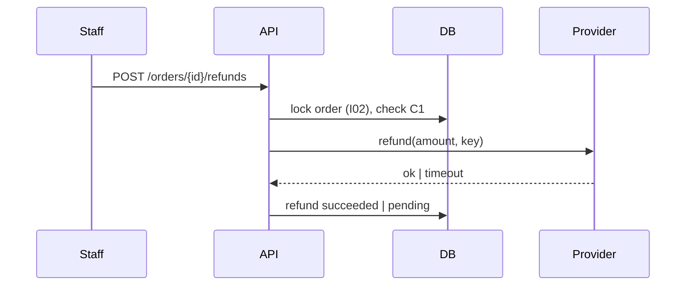

# Plan example: one phase from spec to close

This file follows one phase through its life. Use it to calibrate how much a plan says, and where each fact ends up.

**The phase:** staff of a small shop can refund a captured order, in full or in part. The checkout spec already exists.

## 1. The spec before the phase (excerpt)

```markdown
# Checkout

Covers: cart → order → capture, for buyers and staff. Code: `src/checkout/`, `src/payments/`.

## Rules
- R1 A zero-total order is rejected → 422 `empty_order`.
- R2 An order is captured at most once; a repeated capture returns the first result.
- R6 Captured orders can't change; staff cancel them instead.
```

## 2. The plan

````markdown
# P07 Refunds

Format: 4
Kind: feature
Approved: 2026-11-12 all
Depends on: P05
Touches: `src/payments/`, `src/staff/orders/`, `db/migrations/`, `openapi.yaml`
Read: checkout, D012, I02

## Goal
Staff refund a captured order in full or in part from the order page.

In: staff refunds through the payment provider.
Out: store credit, buyer-initiated refunds, refund reasons.

## Requirements
C1. [checkout R6] Staff may refund a captured order; refunds never exceed captured minus earlier refunds → 422 `refund_exceeds_capture`.
C2. [checkout new] A repeated `Idempotency-Key` returns the first refund and moves no money.
C3. Two concurrent refunds that together exceed the limit: exactly one succeeds, the other gets 422.
C4. Orders captured before this phase are refundable with no backfill.
C5. A provider timeout leaves the refund `pending`; the existing reconcile job settles it. The provider key never appears in logs or errors.
checkout R1–R2 keep holding.

## Design
`openapi.yaml`: add `POST /orders/{id}/refunds` → 201 `Refund` | 404 | 409 `order_not_captured` | 422
Migration: add `refunds(order_id fk, amount_cents > 0, status, idempotency_key unique)`



Owners: refund rules → `src/payments/refunds.ts` (new); money math stays in `src/lib/money.ts`; the provider client stays in `src/payments/provider.ts`.

| Question | Decision | Rejected | Why |
| --- | --- | --- | --- |
| C3 concurrency | Lock the order row in I02's order | Optimistic retry | The provider call can't be safely repeated |
| Timeout handling | `pending` plus the existing reconcile job (D012) | Synchronous retry | A retry after a timeout could refund twice |

## Tasks
- [ ] P07-T01 Store refunds
  Done when: C4 holds; the migration is tested against old-shape rows.
- [ ] P07-T02 Add the refund endpoint
  Done when: C1–C3 and C5 hold, including a two-request race test and a provider-timeout test.
  Checkpoint: first route on the new lock; review it before the UI builds on it.
- [ ] P07-T03 Add refunds to the staff order page
  Done when: staff can refund from the order page; loading, error, and partial-refund states render.

## Acceptance
Auto:
- `pnpm test` → pass
Manual:
- On the provider's test account, refund half an order → the order shows "partially refunded" and the provider shows the refund.

## Log
````

The plan is about 70 lines. The planner also added D012 to DECISIONS as `proposed (P07)` and committed both as `P07 Plan`.

## 3. A task commit

```
P07-T02 Add the refund endpoint

The amount check runs inside the order lock, so two staff refunding at
once can't both pass C1.

Check: pnpm vitest run tests/refunds.test.ts → 14 passed
Choices: amount parsed in the route schema; reused `withTx` from src/db
Follow-up: `src/admin/format.ts` has a second cents formatter (outside Touches)
```

## 4. The Log after review and close

```markdown
## Log

### P07-T02 · cleared · 2026-11-13
Checkpoint: lock and timeout handling match the Design.

### Ready for review · 2026-11-14
Full check → pass. Auto acceptance → pass. Docs check → pass. Phase diff → clean.

### Review 1 · 2026-11-14
- `src/staff/orders/refund.tsx` `RefundForm` — a 422 leaves the button spinning — show the error state → P07-T04
- `src/payments/refunds.ts` `fmtRefund` — duplicates `formatMoney` in `src/lib/money.ts` — use the owner → fixed
- unrelated: no CSV export of refunds → backlog

### Ready for review · 2026-11-14
Full check → pass. P07-T04 only.

### Outcome · 2026-11-15
Delivered: staff refunds, full and partial. Verified P07-T04.
Specs: checkout R6 changed, R9 added.
Manual: pending: half refund on the provider's test account
Backlog: +2
```

There was one review, one fix task, and a check of only that task's commit. The Follow-up trailer and the CSV finding became the 2 backlog lines.

## 5. The spec after close

```markdown
- R6 Staff may refund a captured order, in full or in part; refunds never exceed captured minus earlier refunds → 422 `refund_exceeds_capture` (D012).
- R9 A repeated `Idempotency-Key` on a refund returns the first refund and moves no money.
```

The sequence diagram moved into the spec's Flow section. C3–C5 stayed in the plan: the race test and the timeout test enforce them, and I02 already states the lock order. The next phase that touches checkout cites `checkout R6` and never reads P07.

## What the planner left to the builder

- the refund module's internals: helper names, the lock helper, how the amount is parsed;
- the migration's column details beyond the seam, the indexes, and the status values;
- the UI component structure and its copy;
- test inputs, fakes, and patch targets.

## What the planner kept

- compatibility (C4), failure semantics (C3, C5), and the secret-handling rule;
- the one contract other code depends on (the route) and the persisted shape;
- choices with a real rejected alternative, and the one checkpoint;
- the task order: data, then the route, then the UI.
