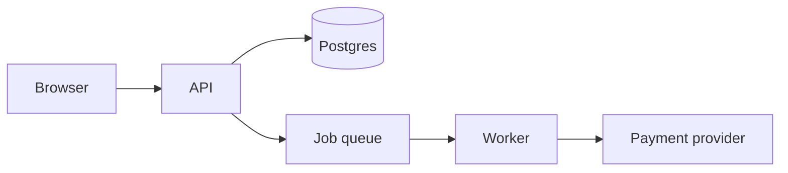
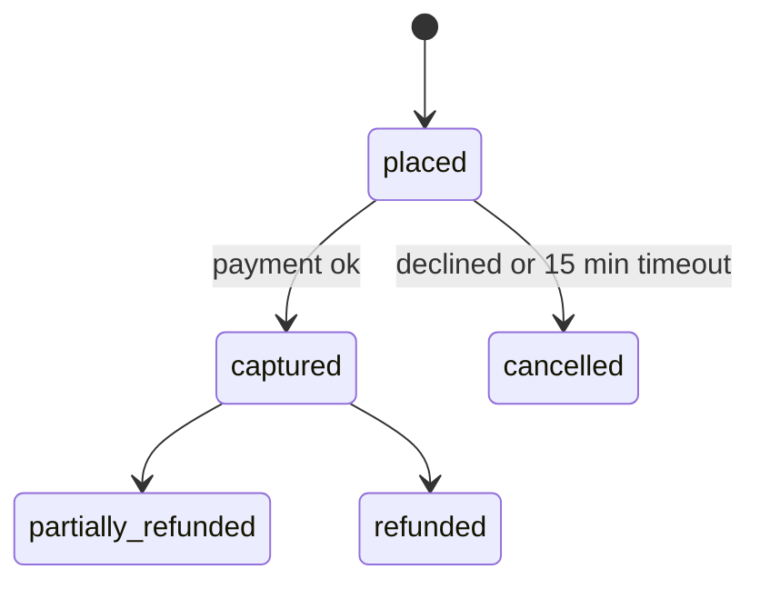

# Record templates

`scripts/check_docs.py` parses these formats. Keep the headings, field names, and ID shapes exactly as shown.

- Replace placeholders with facts, and leave out optional parts you don't use. Never write "none".
- Never record secrets, tokens, personal data, infrastructure IDs, or pasted command output.
- Paths are repo-relative and never carry line numbers (`src/mail/triage.ts`, not `src/mail/triage.ts:120`). The Docs check verifies backticked paths in AGENTS.md, ARCHITECTURE, and specs.

## AGENTS.md

Keep it to 80 lines or fewer, with stable facts only: no status, dates, test counts, or generic style advice.

```markdown
# <App name>

<What it does and for whom, in 1–3 lines.>
Stack: <language, framework, database, key services>.

## Commands
- Setup: `<verified command>`
- Dev: `<verified command>`
- Test one file: `<command with <file> placeholder>`
- Fast check: `<lint + typecheck + unit tests; under ~1 minute>`
- Full check: `<everything CI or release needs>`
- Docs check: `python3 <absolute path to clean-dev>/scripts/check_docs.py .`
- Phase diff: `python3 <absolute path to clean-dev>/scripts/phase_diff.py <phase>`

## Where things live
One owner per concern. Search here before adding shared code; never create a second.
- Config/env: `<path>`
- Logging: `<path>`
- Errors and user-facing messages: `<path>`
- Database access: `<path>`
- HTTP/API client: `<path>`
- Validation schemas: `<path>`
- Dates/time: `<path>`
- Money and number formatting: `<path>`
- Pagination/cursors: `<path>`
- Hashing and IDs: `<path>`
- Retries/backoff: `<path>`
- Shared types/contracts: `<path>`

## Patterns
Copy the shape of these files; extend them instead of starting a parallel style.
- Route: `<path>` (<what to copy, e.g. parse with its schema, call one service, map the result>)
- Service: `<path>` (<…>)
- Schema change: `<path>` (<…>)
- Test: `<path>` (<…>)

## When you change
- <X> → <also do Y> (<the check that catches a miss, if any>)

## Gotchas
- <A trap that cost a fix or a block, and how to avoid it>

## Rules
- <Project hard rule, one line, e.g. "Never hand-edit an applied migration; add a new one.">
- Invariants: [docs/ARCHITECTURE.md](docs/ARCHITECTURE.md#invariants).

## Workflow
Use the clean-dev skill. Status: [docs/ROADMAP.md](docs/ROADMAP.md). Plans: `docs/plans/`. Specs: `docs/specs/`. Decisions: [docs/DECISIONS.md](docs/DECISIONS.md).
- Commit each task as `P07-T03 <task title>` with a `Check:` trailer.
- Never write status or progress in this file.
```

- "Where things live" lists *concerns*, not packages; packages go in the ARCHITECTURE module table. Drop any concern the app doesn't have yet.
- Add a Patterns line only when a good exemplar exists.
- "When you change" and "Gotchas" stay at about 6 lines each. Once a test or generator enforces a co-change, delete its line.

## docs/ROADMAP.md

This is the only place phase status lives.

```markdown
# Roadmap

Goal: <who uses the app and what it does for them, 1–2 sentences>
Not doing: <product-level exclusions>
Constraints:
- Users: <how many, where, how they reach it>
- Data: <volume now and growth per year; what must never be lost>
- Latency: <targets for the main flows, e.g. p95 < 300 ms for page loads>
- Budget: <hosting and per-request cost limits>
- Runs on: <deploy target>

## Phases

| ID | Phase | Status | Plan |
| --- | --- | --- | --- |
| P01 | Walking skeleton | done | [plan](plans/P01-walking-skeleton.md) |
| P02 | Email alerts | approved | [plan](plans/P02-email-alerts.md) |
| P03 | Lead tracking | planned | — |

Outlines:
- **P03** <outcome in one line>. Depends on: P02. Risk: <the main unknown>.

## Backlog

### <Area>
- <idea, request, or bug not yet in a phase> (<source>, <YYYY-MM-DD>)
```

- **Statuses** are `planned`, `approved`, `built`, `done`, and `dropped` (SKILL.md). A dropped phase gives its reason in the Phase cell.
- **Outlines** are 1–3 lines; delete one once its phase has a plan. The **backlog** is grouped by area and pruned at every close.
- **Large apps** group the phase rows under `### <Milestone>` headings inside `## Phases`, one table per milestone.

## docs/ARCHITECTURE.md

This file describes the code as built. Planned structure lives in a plan's Design until it ships. Aim for about 200 lines; area behavior belongs in specs.

````markdown
# Architecture

## Overview
<3–6 lines: the main parts and how they fit.>



Imports flow: `src/routes/` → `src/services/` → `src/db/`; nothing imports `src/routes/`. Enforced by `<lint rule or test>`.

## Modules
| Path | Owns |
| --- | --- |
| `src/routes/` | HTTP handlers: parse input, call services, map errors to responses |
| `src/db/` | All database reads and writes |

## Invariants
- I01 <statement that must always hold> — enforced by `<test or module path>`
- I02 Locks are taken in the order account → order → payment — enforced by `<path>`

## Boundaries
- <external service or storage>: <what we send and receive, who handles its errors, trust level>

## Glossary
- **<Term>**: <what it means here, when the word could mean something else>

## Specs
- [checkout](specs/checkout.md) — cart to refund

## Topic docs
- [DATABASE.md](DATABASE.md) — <one line>
````

[foundations.md](foundations.md) "ARCHITECTURE" says when to draw the diagram and what earns a glossary line or an invariant.

## docs/specs/<area>.md

The current behavior of one area, as built. Name it by domain (`checkout.md`), not by code folder, and keep it to about 150 lines.

````markdown
# Checkout

Covers: cart → order → capture → refund, for buyers and staff. Code: `src/checkout/`, `src/payments/`.

## Rules
- R1 A zero-total order is rejected → 422 `empty_order`.
- R2 An order is captured at most once; a repeated capture returns the first result.
- R6 A refund never exceeds captured minus earlier refunds (D012).

## Flow


## Contracts
- HTTP: `openapi.yaml` (tag `checkout`)
- Schema: `db/schema/orders.sql`
````

Rules are numbered `R1…` and never renumbered; Flow is optional; Contracts point to the files that own the shapes. [foundations.md](foundations.md) "Specs" has the rules for writing one.

## docs/DECISIONS.md

Record only choices a future planner might undo without knowing why. Each entry is 8 lines or fewer, and run results, task notes, and infrastructure IDs never go here.

```markdown
# Decisions

## D001 <Choice as a short phrase> — accepted (P01)
Context: <the problem or constraint, one line>
Decision: <the choice and its main reason>
Rejected: <viable alternative> — <why not, with numbers where scale decided it>
Consequence: <tradeoff or limit future work must respect>
Revisit when: <the measured threshold that would change this>
```

- **Statuses:** `proposed (P07)` while its plan awaits approval or is being built, `accepted (P07)` when P07 closes, and `superseded by D0NN`, keeping the original text. Never rewrite an accepted entry.
- `Rejected:` is required, because a choice with no viable alternative isn't a decision. `Revisit when:` is optional.

## docs/plans/PNN-slug.md

The filename is the phase ID plus a kebab-case slug, and the heading repeats the ID. `Format: 4` marks this version. [planning.md](planning.md) says what goes in each section, and [plan-example.md](plan-example.md) shows a filled one.

````markdown
# P07 <Outcome noun phrase>

Format: 4
Kind: feature
Approved: pending
Depends on: <P05, or none>
Touches: `<package or folder>`, `<shared file: lockfile, schema, openapi.yaml>`
Read: <spec slugs, D and I IDs, backticked paths beyond AGENTS.md>

## Goal
<User-visible outcome in 1–3 sentences.>

In: <included work>
Out: <excluded work that someone might reasonably expect>

## Requirements
C1. [<spec> R6] <Observable behavior that changes rule R6.>
C2. [<spec> new] <Observable behavior that becomes a new rule.>
C3. <Failure case local to this phase: timeout, duplicate, race, old data; the state left behind.>
<spec> R1–R2 keep holding.

## Design
<Only the seams this phase changes, as code and as a delta against their source-of-truth file.>
<A Mermaid diagram when a new flow has more than 3 steps or crosses a process boundary.>
Owners: <new or reused owner per concern, one line each>

| Question | Decision | Rejected | Why |
| --- | --- | --- | --- |
| <consequential question> | <decision> | <viable alternative> | <reason> |

## Tasks
- [ ] P07-T01 <Verb phrase>
  Done when: <C-IDs that hold, and the failure cases tested>.
- [ ] P07-T02 <Verb phrase>
  Done when: <…>.
  Checkpoint: <why to pause here; at most one per phase>

## Acceptance
Auto:
- `<command>` → <expected result>
Manual:
- <action the user can perform> → <expected result>

## Log
````

- **Required:** the header lines `Format`, `Kind`, `Approved`, `Depends on`, and `Touches`, and the sections Goal, Requirements, Tasks, Acceptance, and Log. Design is required when the phase changes a public contract, a persisted format, or the architecture.
- **Tags:** `[slug Rn]` replaces or removes rule Rn of `docs/specs/slug.md`; `[slug new]` adds a rule; an untagged C-item is local to the phase.
- **Task fields:** `Done when:` is required; `Check:`, `Checkpoint:`, and `Avoid:` are optional. A `Spike:` title prefix marks an unknown. Numbering starts at T01.
- **`Approved:`** is `pending`, `2026-10-26 all`, or ranges such as `2026-10-26 T01–T04; 2026-10-27 T05`.
- **A fix plan** (`Kind: fix`) adds this section before Requirements:

  ```markdown
  ## Bug
  Repro:
  1. <minimal step>
  Expected: <behavior>
  Actual: <behavior and the error text, without secrets>
  Cause: `<path>` `<symbol>` — <what goes wrong, and the evidence>
  <or> Cause: unknown — diagnose within `<area>`; collect <evidence>.
  ```

## The Log

`## Log` is the plan's last section. It is append-only and holds only what git doesn't: blocks and their answers, scope changes, review findings, and the outcome. Each entry is a `### <name> · <date>` heading and 8 lines or fewer.

```markdown
### Baseline · 2026-11-12
Full check: `pnpm test` → 2 failing in `tests/legacy.test.ts` (fail before this phase)

### P07-T02 · blocked · 2026-11-13
Question: <what would have to change in the approved design, and why>
Options: A) … B) …. Recommend A because ….

### P07-T02 · cleared · 2026-11-13
Resolution: <the answer, and where the plan changed>

### Changed · 2026-11-13
<the scope change, and who approved it>

### Ready for review · 2026-11-14
Full check → pass. Auto acceptance → pass. Docs check → pass. Phase diff → clean.

### Review 1 · 2026-11-14
- `<path>` `<symbol>` — <what is wrong> — <the fix> → P07-T04 | fixed | backlog | user

### Outcome · 2026-11-15
Delivered: <one or two lines>. Verified P07-T04.
Specs: <spec> R6 changed, R9 added.
Manual: none | passed | pending: <which> | waived by the user: <which>
Backlog: +N
```

- **The builder** writes `Baseline` (only for failures), `blocked`, and `Ready for review`. **The planner or reviewer** writes `cleared` (a block answered or a checkpoint passed), `Changed`, `Review N`, and `Outcome`.
- **A review** with nothing to report says `No findings.`, and a skipped one says `Waived by the user.`

## Commits

Every task is one commit: the task line as the subject, and a body that ends in `Check:` (required), `Choices:`, and `Follow-up:` trailers. [building.md](building.md) "Finish a task" has the format. Other phase commits are `P07 Plan`, `P07 Blocked on T02`, `P07 Ready for review`, `P07 Review 1`, and `P07 Close`. Direct changes commit as `fix: …` or `chore: …`, also with a `Check:` trailer.

## docs/incidents/YYYY-MM-DD-slug.md (optional)

Use this only for a problem in a deployed environment. A local bug only needs a fix plan.

```markdown
# Incident 2026-10-16 Media delivery outage

Impact: <who and what was affected, and for how long>
Cause: <root cause and evidence>
Repair: <what was done, linking the fix phase>
Verification: <how recovery was confirmed>
Prevention: <phase or backlog item that stops a repeat>
```
